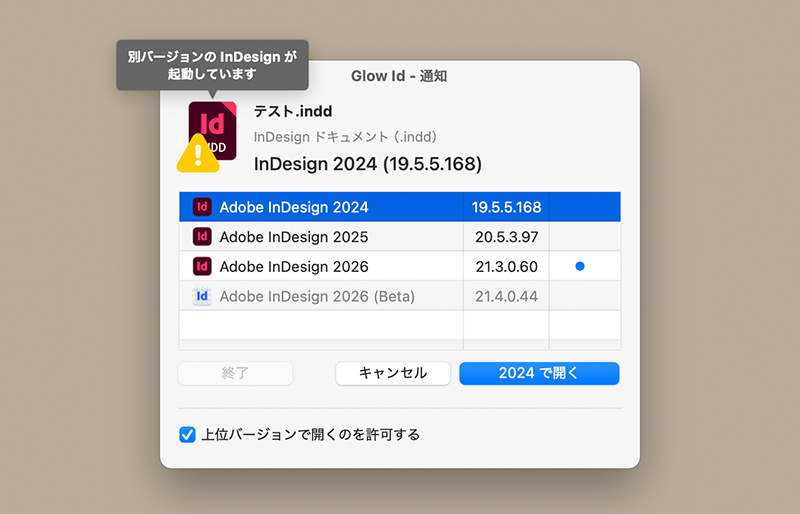

# Glow Id

macOS用デスクトップアプリ

## 用途

Glow Id は、Adobe InDesign ファイル（.indd / .indt / .indb / .indl / .idml）を、そのファイルが作成されたバージョンの InDesign で自動的に開くユーティリティアプリです。

InDesign ファイルは、下位バージョンの InDesign で開けません。さらに、作成バージョンと異なる上位バージョンで開くと、レイアウトが変化してしまうことがあります。トラブルを回避するには、ファイルの作成バージョンを正確に把握し、同じバージョンの InDesign で開く必要があります。

Glow Id は、ファイルの内部に記録されている作成バージョンを読み取り、同じバージョンの InDesign を選んで自動的に開きます。



## 使い方

Glow Id を一度起動すると、.indd / .indt / .indb / .indl / .idml ファイルが Glow Id に自動的に関連付けられます。以降はファイルをダブルクリックするだけで Glow Id が起動し、バージョンを判定して適切な InDesign で開きます。

1. .indd / .indt / .indb / .indl / .idml ファイルをダブルクリックします。
2. Glow Id が起動し、ファイルのバージョンを判定します。
3. バージョンが一致する InDesign が見つかれば自動的に開きます。見つからない場合や、確認が必要な場合は通知ウインドウが表示されます。

詳細は、Glow Id のヘルプメニュー「Glow Id ヘルプ」を選択してください。

## トラブルシューティング

起動時に『Glow Id を「アプリケーション」フォルダへ移動してください』とアラートが出るときの対処方法。

### 原因

ダウンロードした zip には macOS の検疫属性（`com.apple.quarantine`）が付きます。この属性は zip を解凍して出てきたアプリにも引き継がれ、属性が付いたままのアプリは、どこに置かれていても macOS によって一時的な読み取り専用の場所で実行されます（App Translocation）。Glow Id はこの状態を検知して上記のアラートを表示します。

**アプリがアプリケーションフォルダの中にあっても、検疫属性が残っていればこのアラートは出ます。**

### 対処方法 1：ターミナルで検疫属性を外す（確実）

1. Glow Id を終了します。
2. 「ターミナル」アプリを開き、次のコマンドを貼り付けて Return キーを押します。

```
xattr -d com.apple.quarantine "/Applications/Glow Id.app"
```

3. Glow Id を起動します。

引用符を含めて、そのまま貼り付けてください（アプリ名にスペースが含まれるため必要です）。アプリケーションフォルダ以外に置いている場合は、そのパスに読み替えてください。

### 対処方法 2：Finder でアプリ本体を移動する

ターミナルを使わない方法です。**移動するのは zip ではなくアプリ本体**です。

1. Glow Id を終了し、ゴミ箱に入れて削除します。
2. zip を再ダウンロードします。
3. zip は**ダウンロードフォルダに置いたまま**解凍します（ここで Glow Id を起動してはいけません）。
4. 解凍して出てきた「Glow Id」アプリを、Finder で「アプリケーション」フォルダへドラッグします。
5. Glow Id を起動します。

zip をアプリケーションフォルダに移動してからその場で解凍すると、アプリ本体を Finder で移動したことにならないため、検疫属性が外れず解決しません。うまくいかないときは対処方法 1 を使ってください。

## 動作環境

macOS 13.5 Ventura 以降（Universal Binary）

## ライセンス

This project is licensed under the MIT License - see the [LICENSE](LICENSE) file for details.
