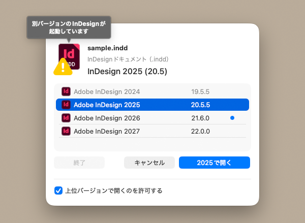

# Glow Id

macOS用デスクトップアプリ

## 用途

Glow Id は、Adobe InDesign ファイル（.indd / .indt / .indb / .indl / .idml）を、そのファイルが作成されたバージョンの InDesign で自動的に開くユーティリティアプリです。

InDesign ファイルは、下位バージョンの InDesign で開けません。さらに、作成バージョンと異なる上位バージョンで開くと、レイアウトが変化してしまうことがあります。トラブルを回避するには、ファイルの作成バージョンを正確に把握し、同じバージョンの InDesign で開く必要があります。

Glow Id は、ファイルの内部に記録されている作成バージョンを読み取り、同じバージョンの InDesign を選んで自動的に開きます。

## 使い方

### 前準備

.indd / .indt / .indb / .indl / .idml ファイルを Glow Id に関連付けておくと、ファイルをダブルクリックするだけで Glow Id が起動し、バージョンを判定して適切な InDesign で開くようになります。

1. Glow Idを起動し、Dockメニューから「設定…」を選択します
2. 設定の「ファイルの関連付け」でGlow Idを選択し、「関連付ける」ボタンを押します
3. 「アイコンを取り込む」ボタンが押せる状態なら押します

この操作で関連付けが変わらない場合は、Finder で .indd ファイルを選んで「情報を見る」を開き、「このアプリケーションで開く」で Glow Id を選んで「すべてを変更…」をクリックしてください。.indt / .indb / .indl / .idml ファイルでも同じ操作をします。

### 使う

1. .indd / .indt / .indb / .indl / .idml ファイルをダブルクリックします
2. Glow Id が起動し、ファイルのバージョンを判定します
	- バージョンが一致する InDesign が見つかれば、自動的にその InDesign で開きます
	- バージョンが一致する InDesign がない場合や、ユーザーの確認を要する場合は、通知ウインドウが表示されます

詳細は、Glow Id のヘルプメニュー「Glow Idヘルプ」を選択してください。

## 動作環境

macOS 13.5 Ventura 以降（Universal Binary）

## ライセンス

This project is licensed under the MIT License - see the [LICENSE](LICENSE) file for details.
