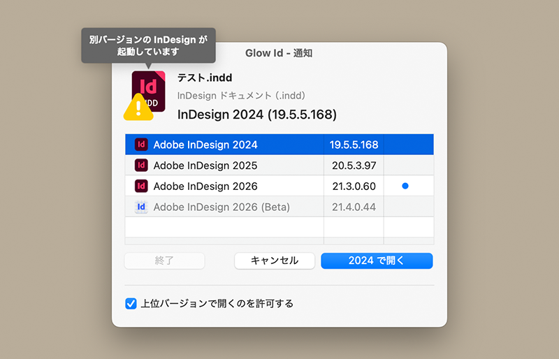

# Glow Id

macOS用デスクトップアプリ

## 用途

Glow Id は、Adobe InDesign ファイル（.indd / .indt / .indb / .indl / .idml）を、そのファイルが作成されたバージョンの InDesign で自動的に開くユーティリティアプリです。

InDesign ファイルは、下位バージョンの InDesign で開けません。さらに、作成バージョンと異なる上位バージョンで開くと、レイアウトが変化してしまうことがあります。トラブルを回避するには、ファイルの作成バージョンを正確に把握し、同じバージョンの InDesign で開く必要があります。

Glow Id は、ファイルの内部に記録されている作成バージョンを読み取り、同じバージョンの InDesign を選んで自動的に開きます。

## 使い方

.indd / .indt / .indb / .indl / .idml ファイルを Glow Id に関連付けておくと、ファイルをダブルクリックするだけで Glow Id が起動し、バージョンを判定して適切な InDesign で開きます。

Glow Id は、ファイルの関連付けを自動では変更しません。関連付けるには、環境設定の「ファイルの関連付け」で Glow Id を選んで「関連付ける」をクリックしてください。macOS Tahoe 26.4 以降は、書類の種類ごとに macOS の確認メッセージが表示されるので、Glow Id への変更を選んでください。元に戻すには、同じ場所で InDesign を選びます。

環境設定で関連付けが変わらない場合は、Finder で .indd ファイルを選んで「情報を見る」を開き、「このアプリケーションで開く」で Glow Id を選んで「すべてを変更…」をクリックしてください。.indt / .indb / .indl / .idml ファイルでも同じ操作をします。

1. .indd / .indt / .indb / .indl / .idml ファイルをダブルクリックします。
2. Glow Id が起動し、ファイルのバージョンを判定します。
3. バージョンが一致する InDesign が見つかれば自動的に開きます。見つからない場合や、確認が必要な場合は通知ウインドウが表示されます。

詳細は、Glow Id のヘルプメニュー「Glow Idヘルプ」を選択してください。

## トラブルシューティング
起動時に『Glow Idをアプリケーションフォルダへ移動してください』または『Glow IdをFinderで移動し直してください』とアラートが出たときの対処方法。

1. アラートの「終了」をクリック
2. Finder で Glow Id をアプリケーションフォルダへ移動（すでにアプリケーションフォルダにある場合は、いったんデスクトップへ移動してから戻す）
3. Glow Id を起動

## 動作環境

macOS 13.5 Ventura 以降（Universal Binary）

## ライセンス

This project is licensed under the MIT License - see the [LICENSE](LICENSE) file for details.
